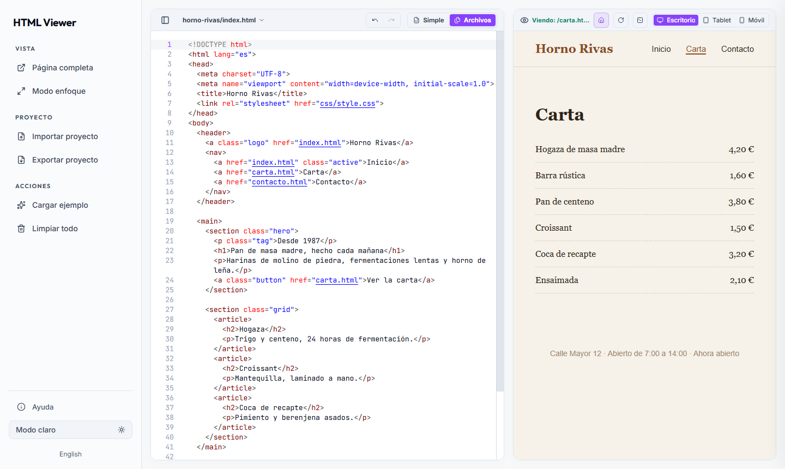
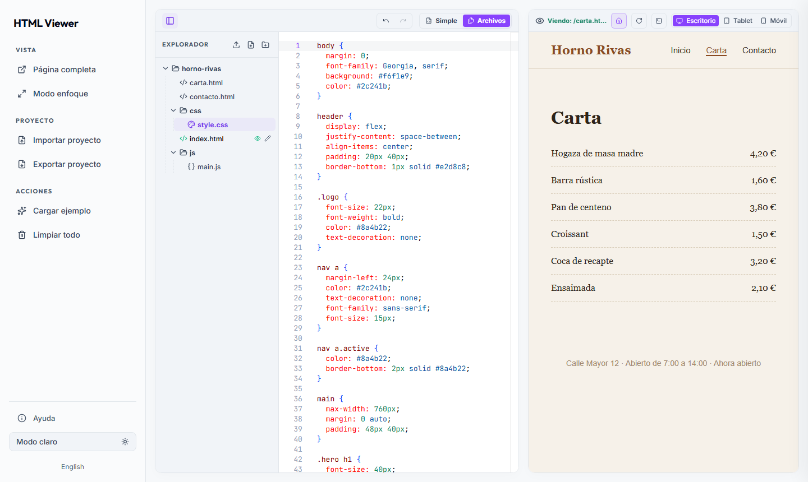

# HTML Viewer

**Arrastra tu proyecto web a la ventana y míralo funcionando al instante.**
Sin instalar nada, sin configurar nada y sin crear cuentas. Sirve igual para un
único `.html` que para un sitio completo con decenas de páginas, carpetas y recursos.

**[Abrir HTML Viewer →](https://kakauet.github.io/HTML-Viewer/es/)**


## Cómo se usa

1. Abre la web.
2. Suelta tu archivo, carpeta o ZIP en cualquier parte de la ventana.

No hay un tercer paso. La vista previa aparece en cuanto termina la importación.

| Si sueltas… | HTML Viewer… |
| --- | --- |
| Un archivo `.html` | Lo abre en modo Simple, con el código a un lado y el resultado al otro. |
| Una carpeta o un `.zip` | Carga el proyecto entero, cambia al modo Archivos y elige solo la página de entrada, aunque esté dentro de una subcarpeta como `dist/`. |
| Varios archivos a la vez | Los reúne en un proyecto. |
| Archivos sobre el explorador | Los añade al proyecto abierto, en la carpeta donde los sueltes. |

## Pensado para el mínimo de clics

Cada decisión de la interfaz busca lo mismo: que pases de tener el proyecto a
verlo funcionando con la menor fricción posible.

- **No hay diálogo de importación.** Sueltas el proyecto donde quieras y la app
  decide qué es y cómo abrirlo.
- **No hay que elegir la página de inicio.** Se detecta automáticamente; si
  quieres otra, la cambias en el selector.
- **No hay botón de ejecutar.** La vista previa se actualiza mientras escribes.
- **El sitio se navega como si estuviera publicado.** Los enlaces entre páginas,
  las rutas limpias (`/blog/`), las anclas (`/#contacto`), Atrás y Recargar
  funcionan dentro de la vista previa.
- **Página completa a un clic** (o `Ctrl + P`), y en ella también puedes navegar
  por todo el sitio.
- **Nada se pierde al cerrar.** El trabajo se recupera al volver a abrir la app
  en el mismo navegador (salvo que borres sus datos).

Atajos: `Ctrl + O` importar, `Ctrl + S` exportar, `Ctrl + P` página completa,
`Ctrl + Z` / `Ctrl + Y` deshacer y rehacer. En macOS, `⌘` en lugar de `Ctrl`.

| Modo claro | Proyecto con varios archivos |
| --- | --- |
|  |  |

## Proyectos complejos

La vista previa sirve el proyecto desde un servidor virtual dentro de tu
navegador, así que funcionan cosas que un visor de HTML normal rompe:

- sitios compilados (la carpeta `dist/` o `build/` de Vite, Astro, React…);
- rutas que empiezan por `/` y URLs limpias sin `.html`;
- `localStorage`, cookies e IndexedDB, como en un sitio publicado;
- archivos antiguos con codificaciones como ISO-8859-1, que conservan sus acentos.

Lo que no puede hacer es compilar por ti. Si tu proyecto necesita `npm run build`
o un servidor propio, compílalo antes y suelta la carpeta resultante.

## Privacidad y seguridad

- Los archivos se procesan en tu navegador; no se suben a ningún sitio. No hay
  analítica, publicidad, cuentas ni backend.
- La página previsualizada tiene su propio almacenamiento y sus propias cookies,
  separados de los del editor, y no puede leer los archivos de la app.
- En modo Simple y en Página completa, la página se ejecuta totalmente aislada
  del editor. En modo Archivos comparte origen con él para poder servir el
  proyecto, así que ábrelo solo con proyectos en los que confíes.
- El código que previsualizas puede hacer sus propias peticiones a Internet.

## Desarrollo

Necesitas Node.js 24 y npm.

```sh
npm ci
npm run build
npm run preview
```

Abre <http://127.0.0.1:8000>. Para alojarlo solo hay que servir `dist/`, sin
Node.js. El modo Archivos necesita HTTPS o localhost para su Service Worker.

```sh
npm run dev
npx playwright install chromium
npm test
npm run test:dist
```

`npm run dev` sirve el directorio de trabajo; tras editar las fuentes, ejecuta
`npm run build`. `npm test` cubre el editor, la importación y la navegación de la
vista previa. `test:dist` prueba la compilación final en la raíz y en una
subcarpeta sin cabeceras especiales, como en GitHub Pages. GitHub Actions ejecuta
las pruebas en cada push y pull request.

- `src/app/`: lógica del editor y de la vista previa ([detalles](src/app/README.md)).
- `src/site/`: plantillas del editor y de la Página completa.
- `preview-sw.js`: servidor virtual de proyectos dentro del navegador.
- `styles.css`, `layout.css`: estilos.
- `assets/`, `vendor/`: Monaco, fuentes, bibliotecas y sus licencias.
- `public-files.mjs`: lista explícita de archivos que se publican.
- `scripts/`, `tests/`: servidor local y pruebas.

Son generados, no los edites: `dist/`, `index.html`, `es/index.html`,
`preview.html`, `404.html`, `app.bundle.js`, `*.min.css`, `lucide.min.js` y
`jszip.min.js`.

### Publicar tu propia copia

1. En **Settings → Pages → Build and deployment**, elige **GitHub Actions**.
2. El workflow `Publish GitHub Pages` construye, verifica y publica `dist/` en
   cada push a `main`, o cuando lo lanzas desde **Actions**.

Funciona en un dominio raíz y en `https://usuario.github.io/repositorio/`; el
workflow define `BASE_PATH` por ti. Si compilas a mano para una subcarpeta, usa
`BASE_PATH=/nombre-del-repositorio`. `netlify.toml` permite publicar el mismo
`dist/` en Netlify, que además aplica las cabeceras de `_headers`.

## Licencia

Código bajo licencia [MIT](LICENSE). Las dependencias conservan sus licencias;
consulta [THIRD-PARTY-NOTICES.md](THIRD-PARTY-NOTICES.md).
