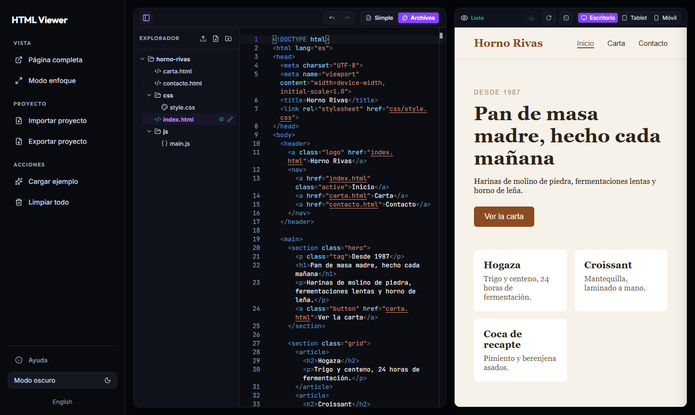

# HTML Viewer

Abre un proyecto web, míralo funcionar y edítalo desde el navegador.
HTML Viewer está pensado para pasar de una carpeta de archivos a una vista
previa con la mínima fricción: arrastrar, abrir y empezar a trabajar.

**[Abrir HTML Viewer · instantviewer.online](https://instantviewer.online)**



## Cómo funciona

1. Arrastra un HTML, una carpeta o un ZIP a la ventana. También puedes usar Importar.
2. El visor detecta la página de entrada y abre la vista previa.
3. Edita el código y comprueba los cambios mientras escribes.
4. Guarda el resultado como HTML, ZIP o carpeta, si tu navegador lo permite.

Un HTML se abre en **Simple**, con el código y el resultado uno al lado del otro.
Las carpetas, los ZIP y los grupos de archivos se abren en **Archivos**, con un
explorador para moverte por el proyecto. Si sueltas archivos sobre el explorador,
se añaden al proyecto que ya tienes abierto.

## Qué tiene de especial

Está pensado para abrir proyectos grandes y revisarlos con rapidez, sin preparar
un entorno de desarrollo para cada uno. La interfaz reúne el explorador, las
pestañas, el editor y la vista previa para que puedas encontrar un archivo,
cambiarlo y ver el resultado en el mismo sitio.

- **Importación directa.** Puedes abrir el proyecto completo sin subir cada archivo por separado.
- **Entrada automática.** Busca la página inicial, también dentro de carpetas como `dist/` o `build/`.
- **Recursos del proyecto.** Conserva carpetas, imágenes, fuentes, CSS, JavaScript y módulos ES.
- **Navegación real.** Puedes recorrer páginas, rutas limpias, anclas y aplicaciones SPA dentro de la vista previa.
- **Edición inmediata.** La vista previa se actualiza al escribir; los cambios del proyecto se sincronizan por archivos.
- **Controles a mano.** Página completa, tamaños de pantalla, zoom, deshacer y rehacer, tema claro y oscuro y diagnóstico de errores.

Funciona con páginas HTML sueltas, sitios de varias páginas y la salida compilada
de herramientas como Vite o Astro. Para proyectos que necesitan compilación,
importa el resultado que normalmente publicarías en un servidor web.

## Tus archivos

Los archivos se procesan en tu navegador. La importación no los sube a un servidor.
El editor guarda una copia de recuperación local cuando el navegador lo permite;
exporta tu trabajo para conservar una copia independiente.

El código que abres puede conectarse a Internet y a APIs externas. Esas conexiones
dependen del servidor de destino, sus permisos CORS y la configuración del propio
proyecto. HTML Viewer no arranca servidores Node, PHP o Python.

## Ejecutarlo en local

Con Node.js 24 y npm:

```sh
npm ci
npm run build
npm run preview
```

Abre [localhost:8000](http://127.0.0.1:8000). Para desarrollar, `npm run dev` sirve
el directorio de trabajo; vuelve a ejecutar el build tras cambiar las fuentes.

El sitio publicado sirve los archivos de `dist/`. En Netlify, la configuración
incluida construye el proyecto y usa la URL propia del despliegue para separar
la previsualización del editor, sin contratar otro dominio. Un alojamiento
estático sin ese segundo origen conserva el modo compatible para proyectos de
confianza. Si el navegador bloquea el aislamiento, el visor avisa y utiliza ese
modo compatible. El modo Archivos necesita HTTPS o localhost.

## Pruebas

```sh
npx playwright install chromium firefox webkit
npm run test:browsers
npm run test:dist
```

Las pruebas cubren importación, edición, recursos, navegación y aislamiento.
Los detalles del código están en [src/app/README.md](src/app/README.md).

## Licencia

[MIT](LICENSE). Consulta las licencias de las dependencias en
[THIRD-PARTY-NOTICES.md](THIRD-PARTY-NOTICES.md).
